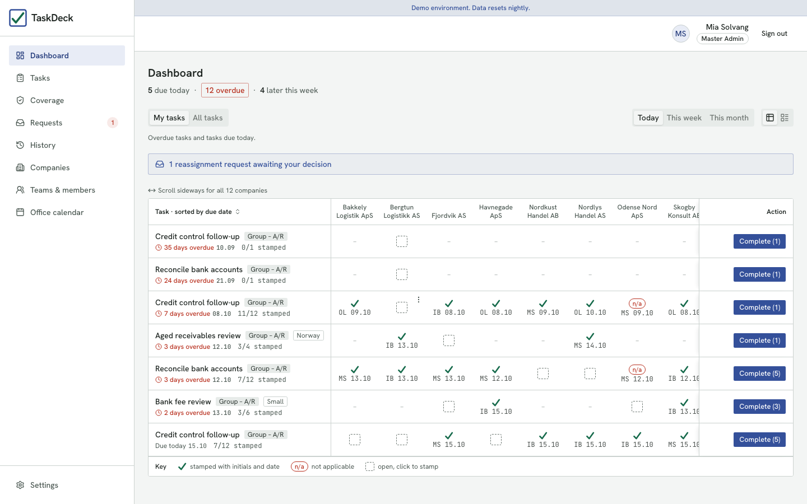
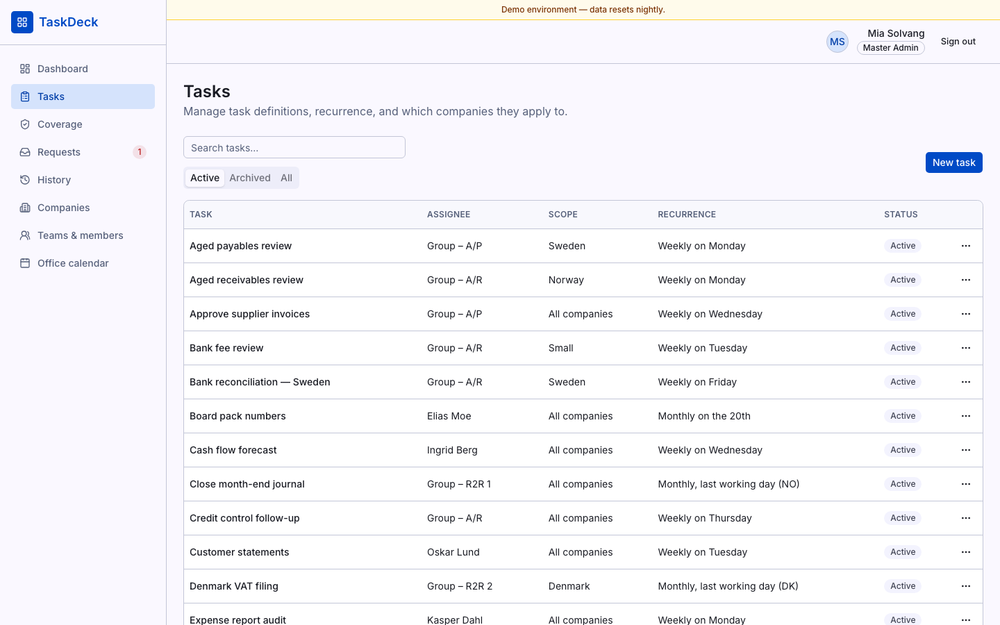
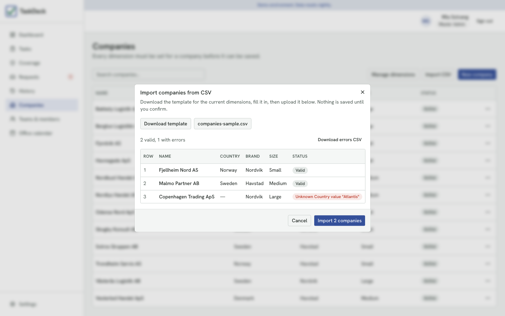
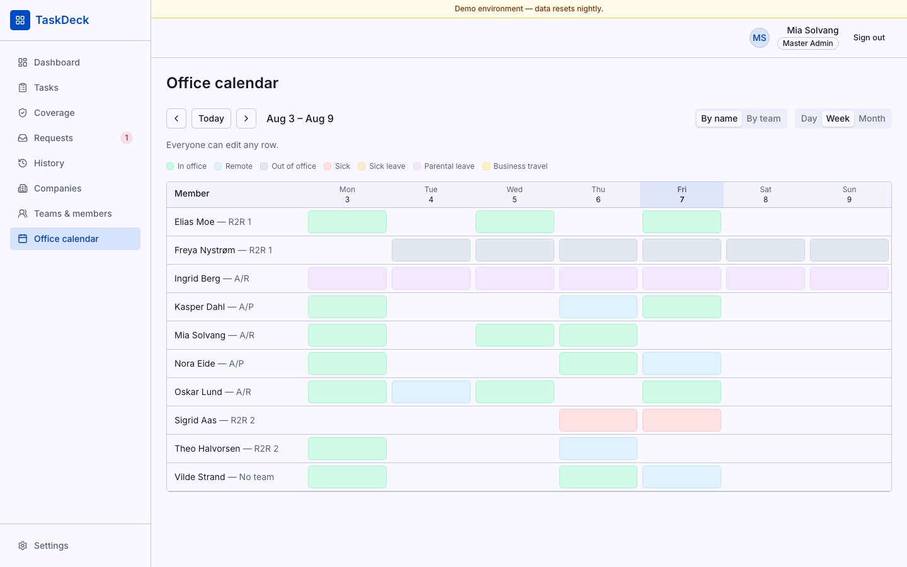
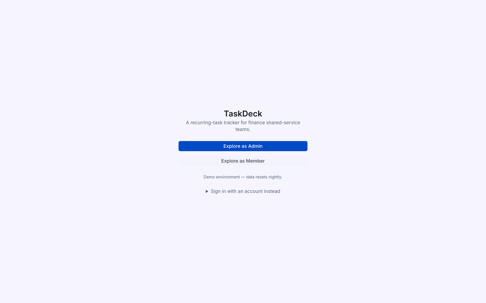
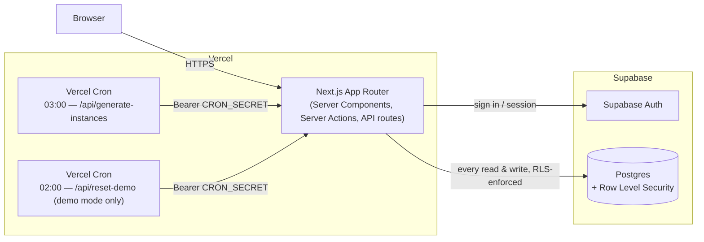

# TaskDeck

[](https://github.com/echosmasher/taskdeck/actions/workflows/ci.yml)

TaskDeck is a recurring-task tracker for any office team that runs the same checklist across a portfolio of companies, clients, branches, or accounts every week or month, and needs to prove it happened: who completed which one, and when. It fans a single task definition out into one independently-stamped checkbox per company, understands working-day deadlines ("2nd working day," "last working day of the month"), and treats the audit trail, not the checkbox, as the actual product.

It grew out of a finance shared-service use case (bank reconciliations, VAT return reviews across a client portfolio), but the model is domain-agnostic: any workspace where recurring tasks get assigned to a team or person and checked off per entity — HR compliance across office locations, account management across client accounts, IT across sites — fits the same shape.

**Live demo:** [taskdeck-mocha.vercel.app](https://taskdeck-mocha.vercel.app) — "Explore as Admin" or "Explore as Member," no signup, real (reset-nightly) data.

## Screenshots

| Dashboard | Task admin |
|---|---|
|  |  |

| CSV import preview | Office calendar |
|---|---|
|  |  |

| Demo landing |
|---|
|  |

## Features

- **Dashboard** — Today/This week/This month, My tasks/All tasks, an overdue banner, and a per-company checklist under every task row (Complete / N/A / Reopen, each independently stamped and logged).
- **Tasks admin** — weekly, monthly-fixed-date, and monthly-Nth-working-day recurrence (including negative N for "Nth-last working day"); scope by any combination of dimensions; copy-from-existing to prefill a new task; absence-aware assignment warnings that never block saving.
- **Companies admin** — CRUD with per-dimension values; a guided backfill flow when a new dimension is added after companies already exist; CSV import with a validated preview (nothing is written until you confirm) and a downloadable errors CSV.
- **Teams & members** — CRUD, role management, empty-team warnings.
- **Office calendar** — day/week/month views, sortable by name or team, three configurable edit-permission modes (admins only / members edit their own row / members edit anyone's), enforced in RLS, not just the UI.
- **History** — a filterable audit trail of every completed/N-A instance, with the full event timeline (created → completed → reopened → completed…) per row.
- **Coverage** — surfaces exactly the open instances whose assignee is long-term absent, with a bulk "assign coverage" action.
- **Reassignment requests** — members can ask for a task or a specific occurrence to be reassigned; only an admin can approve or reject it. Never a direct write — see [Design decisions](#design-decisions) and the RLS tests below.
- **Settings** — calendar edit permission, long-absence thresholds, timezone; every change is itself audit-logged.
- **Demo mode** — a public, zero-signup landing page ("Explore as Admin" / "Explore as Member"), a "data resets nightly" banner, and a nightly reset job that restores a realistic seeded dataset (~12 companies, ~25 tasks, absence/coverage/request fixtures) so the demo never rots.

## Architecture



Every table has Row Level Security enabled; the Next.js server never uses a privilege-bypassing client for a request made on a user's behalf. The service-role (RLS-bypassing) client is reserved for exactly three trusted, non-user-triggered contexts: the master-admin bootstrap, the demo seed/reset job, and RLS test fixtures.

## Data model

| Table | Purpose |
|---|---|
| `profiles`, `teams` | Users (extending `auth.users`) and departments; `role` is `master_admin` \| `admin` \| `member` |
| `companies`, `dimensions`, `dimension_values`, `company_dimension_values` | The portfolio of companies/entities tasks are tracked against, scoped by admin-defined dimensions (Country, Brand, Size, …) — a company's dimension values are rows, not columns, so every dimension behaves identically |
| `tasks` | Task definitions: assignee (team **or** person), scope (which dimension values it applies to), recurrence, deadline rule |
| `task_instances` | One row per `(task, company, due_date)` — the thing that actually gets checked off. Carries `status`, who set it and when, and an optional `assignee_override_profile_id` for coverage |
| `task_events` | Append-only audit log — every created/completed/reopened/reassigned/override event, per instance |
| `calendar_entries` | One status per member per day (in office, remote, sick, parental leave, …) |
| `holidays` | Per-country public holidays, used by the working-day recurrence engine |
| `app_settings`, `settings_events` | A singleton row of admin-configurable settings, itself audit-logged |
| `reassignment_requests` | A member's request to hand off a task/occurrence; only an admin's decision can act on it |

Companies, teams, members, and tasks are archived, never hard-deleted, once they have history — see [Design decisions](#design-decisions).

## Local setup

Requires Node 22+, [pnpm](https://pnpm.io), and the [Supabase CLI](https://supabase.com/docs/guides/cli).

```bash
pnpm install
supabase start          # applies every migration in supabase/migrations/
cp .env.example .env.local
# fill NEXT_PUBLIC_SUPABASE_URL / NEXT_PUBLIC_SUPABASE_ANON_KEY / SUPABASE_SERVICE_ROLE_KEY
# from `supabase status`; set SEED_MASTER_ADMIN_EMAIL to your own email;
# set DEMO_MODE=true and the DEMO_ADMIN_*/DEMO_MEMBER_* pairs to try demo mode locally
pnpm seed                # idempotent — creates the demo dataset described above
pnpm dev
```

Open http://localhost:3000. With `DEMO_MODE=true` you'll land on the demo buttons; otherwise sign in with the email you set as `SEED_MASTER_ADMIN_EMAIL` (any password on first login creates the account, promoted to `master_admin` automatically).

## Testing

```bash
pnpm test        # unit tests (Vitest) — recurrence/working-day logic, CSV parsing, absence classification, scope matching
pnpm test:rls    # RLS integration tests — needs the local Supabase stack from `supabase start`
pnpm test:e2e    # Playwright E2E smoke tests — starts its own dev server, needs the local Supabase stack
```

CI (`.github/workflows/ci.yml`) runs lint, typecheck, and `pnpm test` on every push. `test:rls`/`test:e2e` need a live Postgres instance and are meant to be run locally before pushing, not in CI.

`test:rls` covers the two things spec-required for RLS: the office calendar's three edit-permission modes, and that a member can never reassign a task directly (blocked by policy) or set a coverage override (blocked by a trigger) — only request one. `test:e2e` covers sign-in for both demo roles, admin-route protection, and the full request → approve → override flow end to end, including the override actually appearing on the covering member's own dashboard.

## Design decisions

**Per-company instances, not one checkbox per task.** "Reconcile bank accounts" (or "renew the site's fire safety cert," or any other recurring per-entity job) for a portfolio of 8 companies isn't one unit of work — it's 8, each completed by a possibly different person on a possibly different day. The instance (not the task) is the audit unit, because the instance is what the audit evidence is actually about.

**Working-day deadlines, including negative N.** Recurring office checklists are often defined in business-day terms — "2nd working day," "last working day of the month" — not calendar dates, whether that's a finance close, a payroll cutoff, or a compliance review. Supporting `-1` for "last working day" (and any `-N`) is what makes the recurrence engine actually fit a real business calendar instead of being a generic scheduler with a working-day flag bolted on.

**Archive, never hard-delete.** The audit trail is the point of the product; hard-deleting a company or team would erase the record of who did what and when. Hard delete only exists for records with zero task history — nothing that ever mattered can quietly disappear.

**Absence warns, it never blocks.** Assignment lives on the task definition and is indefinite; absence lives on calendar days and is time-bounded. A hard validation rule coupling the two fails exactly when it matters most — someone calling in sick with instances due that same day, and the checklist that day is precisely when it can't afford to be unusable. Instead: warn at assignment time, and handle the actual gap with per-occurrence coverage.

**Coverage is an instance-level override, not a task reassignment.** An `assignee_override_profile_id` on `task_instances` applies to one `(task, company, due_date)` — an admin can cover a single month, or a subset of companies, without touching the recurring task definition. When the absence ends, future instances revert automatically; there's nothing to clean up and no history is lost the way a temporary reassign-and-reassign-back would lose it.

**Members can only ever request a reassignment, never make it.** `tasks_write` and the coverage-override trigger are both admin-only at the database level — not just hidden in the UI — so "members can't reassign directly" is a guarantee the RLS test suite actually checks, not a convention the frontend happens to follow today.

## Roadmap (explicitly out of scope for v1)

- Email/Slack notifications and deadline reminders.
- Linking calendar absence directly to reassignment *suggestions* (today it's a warning; a human still decides).
- Company portfolio ownership (routing a team task to a specific owner's companies automatically) — assignment stays at the task level in v1.
- CSV/Excel export of the History view's filtered results.
- SSO / multi-tenant workspaces.
